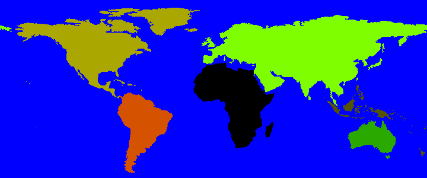

# Glossary

— **Languoid**: A dialect, language or language family. A more extensive definition can be found in
[Nordhoff & Hammarström (2011)](http://ceur-ws.org/Vol-783/paper7.pdf).

— **Family**: A **genealogical** grouping of languages. In Glottolog, each node in the classification
tree between root and a language node is called a *family*. Sometimes, *sub-family* or *top-level family*
is used to distinguish between inner nodes and root nodes.

For non-genealogical groups see [pseudo-families](#pseudofamilies).

— **Isolate**: A language which is not contained in any genealogical group.

— **Glottocode**: Each languoid has a unique and persistent identifier called **Glottocode**, consisting 
of four alphanumeric characters (i.e. lowercase letters or decimal digits) and four decimal digits 
(`abcd1234` follows this patters, but so does [`b10b1234`](https://glottolog.org/resource/languoid/id/b10b1234)).
A more extensive description can be found in [Hammarström and Forkel (2022)](https://doi.org/10.3233/SW-212843).

— **Doculect**: The language variety described in a specific document. For example, whatever language 
data is contained in a certain dictionary, grammar or specific article represents a unique doculect, 
without specifying whether that data constitutes an idiolect, a dialect, a variety mutually intelligible 
to some other variety or a mix of varieties from various locales.

— **Document type**: The class a document (referenced in Glottolog's bibliography) belongs to. A document 
can belong to more than one class. Document types are listed in [document_types.ini](../config/document_types.ini).

— **Macro-area**: An area of the globe of roughly continent size.
Macro-areas are listed and described in [macroareas.ini](../config/macroareas.ini).

— **Pseudo-families**: Sign Languages, Mixed Languages, Pidgins and Artificial Languages are treated 
as families in Glottolog, even though they cannot be readily classified genealogically. These groups 
all share some features, which makes it convenient to treat them as if they were families.

These pseudo-families - including the Glottocode of the respective top-level languoid - are described
in [language_types.ini](../config/language_types.ini).

— **Unclassified languages**: Languages for which we have some lexical and/or grammatical information, 
but this information is so scant that it cannot be decided whether or not it is genealogically related 
to any other language. They are treated as belonging to the top-level pseudo-family „Unclassified“.

(See also ["About languoids"](languoids.md).)

— **Unclassified languoid in family X**: A languoid for which

1. enough lexical and/or grammatical information is available to assign it to a family, but for which
2. its position within that family has not been resolved (either because of lack of data or because 
   of lack of investigation).

(See also ["About languoids"](languoids.md).)

— **Unattested language**: A language for which we have convincing evidence of its existence and distinctness 
from all other languages, but no grammatical or lexical information is available.

Unattested languages can often be assigned to a family on non-linguistic grounds, but here they are treated 
as belonging to the pseudo-family „Unclassified“.

(See also ["About languoids"](languoids.md).)

— **Spurious languoid**: A languoid which is cited in the literature, but whose existence is not proven 
beyond doubt. This includes super-families like Amerind and small languages or dialects which somehow 
made it into other language catalogues without proof that they actually do exist.

(See also ["About languoids"](languoids.md).)

— **Most Extensive Description (MED)**: The Most Extensive Description (MED) for a language is the longest 
document of the highest ranking [document type](#documenttype). From highest to lowest, the ranking is
- grammar,
- grammar sketch, 
- dictionary/phonology/specific feature/text, 
- wordlist, 
- followed by the remaining document types. 

Note that 'description' here refers to grammatical description rather than, e.g., lexical documentation, 
so grammar trumps dictionary.

(See also ["About GlottoScope"](glottoscope.md).)

— **Descriptive status of a language**: The descriptive status of a language is the [document type](#documenttype) 
of its [MED](#med). For example, in the case of language for which there is a grammar sketch, a phonology 
and a dictionary, its MED would be the grammar and so the descriptive status would be 'grammar'. It does 
not matter if there are fifty grammars for the language or just one, the descriptive status would still 
be 'grammar'.

(See also ["About GlottoScope"](glottoscope.md).)

— **Computerized assignment**: A large class of the bibliographical references have been annotated manually 
for language and document type, sometimes via a decent translation of another annotation scheme than the 
one used on Glottolog. However, a large class of references have not been manually annotated. Such references 
are automatically tagged on the basis of words that occur in the title. For example, if the title of a 
bibliographical reference contains the name of a language, it may be guessed to pertain to that language. 
Similarly, if it contains the word 'dictionary' it is probably of the document type dictionary. Which words 
trigger which annotations is automatically learned from manually tagged training data (see Hammarström 2008 
for details). The automatic annotation is far from perfect, but is nevertheless applied since it does 
more good than harm. However, assignments which are triggered by words in the title in this way, as 
opposed to manual annotations, are marked as "computerized assignment".

> Harald Hammarström. 2008. Automatic Annotation of Bibliographical References with Target Language. Proceedings of MMIES-2: Workshop on Multi-source, Multilingual Information Extraction and Summarization, 57-64. ACL.
