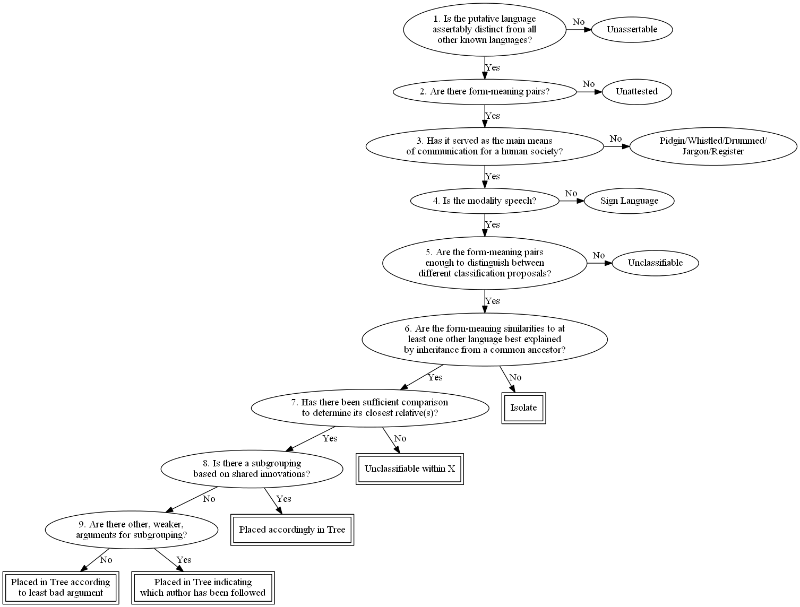

# About Languoids

Glottolog aims to provide a comprehensive list of [languoids](glossary.md#languoid) (families, languages, 
dialects) that linguists need to be able to identify. Each languoid has a unique and persistent identifier 
called [Glottocode](glossary.md#glottocode) ([Hammarström and Forkel (2022)](https://doi.org/10.3233/SW-212843)).

Languages are classified (see below) into [*families*](glossary.md#family) and [*isolates*](glossary.md#isolate).
This classification is the best guess by the Glottolog editors and the classification principles are 
described below. Users should be aware that for many groups of languages, there is little available
historical-comparative research, so the classifications are subject to change as scholarship and interest in
those languages increase. Please [contact](mailto:glottolog@eva.mpg.de) the editors if you have corrections 
to the language classification.

In addition to the genealogical trees (families and isolates), the Glottolog also includes the following
**non-genealogical trees** (or [pseudo-families](glossary.md#pseudofamilies)):

- Sign Language
- Unclassifiable
- Pidgin
- Unattested
- Artificial Language
- Speech Register
- Mixed Language

These are listed and described in [language_types.ini](../config/language_types.ini).

Glottolog also contains lists of putative languages that are not regarded as real languoids by 
the editors but that are given a Glottocode for bookkeeping purposes; these are called 
**bookkeeping languoids** and they are described further below.

## Classification principles
                
Every putative language is considered according to the decision procedure in the figure below.
All spoken languages for which a sufficient amount of linguistic data exists—the leaves of the
decision tree with double boxes around them—are deemed classifiable, and are classified
into genealogical families (and isolates). The other kinds of languages are filed into
the other categories that were listed above. Glottolog is complete only for classifiable languages.
Regarding unattested and unclassifiable languages, see [Hammarström (2015)](https://doi.org/10.1353/lan.2015.0038).

A comprehensive listing of pidgins is 
[Bakker and Parkvall (2010)](https://glottolog.org/resource/reference/id/hh:hb:BakkerParkvall:Pidgin).
This listing differentiates different levels of evidence for the existence of a pidgin, rather than a 
strict yes/no existence-decision.

Elsewhere there are extensive lists of 
- whistled languages
  ([Meyer 2015](https://glottolog.org/resource/reference/id/hh:h:Meyer:Whistled:2015), 
  [Busnel and Classe 1976](https://glottolog.org/resource/reference/id/hh:h:BusnelClasse:Whistled), 
  [Harrisson 1965](https://glottolog.org/resource/reference/id/hh:e:Harrisson:Borneo-Nomads),
  [Thierry 2002](https://glottolog.org/resource/reference/id/hh:h:Thierry:Siffles),
  [Kouneli et al. 2013](https://glottolog.org/resource/reference/id/hh:hld:Kouneli:Whistled-Greek)), 
- initiation languages 
  ([Ngonga-ke-Mbembe 2009](https://glottolog.org/resource/reference/id/hh:ld:Ngonga-ke-Mbembe:Initiatique-Ohendo), 
  [James 2021](https://glottolog.org/resource/reference/id/hh:h:James:Speech-Surrogates), 
  [Storch et al. 2024](https://glottolog.org/resource/reference/id/hh:h:Storch:Atlantic-Secret), 
  [Moñino 1977](https://glottolog.org/resource/reference/id/hh:typ:Monino:Labi), 
- ritual languages 
  ([Brindle et al. 2015](https://glottolog.org/resource/reference/id/hh:ld:Brindle:Kiliji),
  [Reinöhl 2025](https://glottolog.org/resource/reference/id/hh:typ:Reinohl:Igu), 
  [Moser 1083](https://glottolog.org/resource/reference/id/hh:es:Moser:Ngoni)), 
- secret languages 
  ([Dugast 1950](https://glottolog.org/resource/reference/id/hh:ld:Dugast:Njoya),
  [Ittman 1959](https://glottolog.org/resource/reference/id/hh:s:Ittman:Nixenkultbundes),
  [Beaujard 1998](https://glottolog.org/resource/reference/id/hh:w:Beaujard:Arabico-Malgache), 
  [Berjaoui 2016](https://glottolog.org/resource/reference/id/hh:ldsoc:Berjaoui:Amazigh-Secret),
  [Berjaoui 2009](https://glottolog.org/resource/reference/id/hh:soc:Berjaoui:Moroccan), 
  [Leiris 1948](https://glottolog.org/resource/reference/id/hh:s:Leiris:Dogons), 
  [Leslau 1864](https://glottolog.org/resource/reference/id/hh:hvld:Leslau:Ethiopian-Argots), 
  [Debrunner 1962](https://glottolog.org/resource/reference/id/hh:h:Debrunner:Vergessene-Togorestvolkern), 
  [Thomas 1914](https://glottolog.org/resource/reference/id/hh:hw:Thomas:Southern-Nigeria), 
  [James 2021](https://glottolog.org/resource/reference/id/hh:h:James:Speech-Surrogates)) and 
- drummed languages 
  ([Betz 1891](https://glottolog.org/resource/reference/id/hh:ld:Betz:Trommelsprache-Duala), 
  [Carrington 1949](https://glottolog.org/resource/reference/id/hh:ld:Carrington:Gong), 
  [Arom et al. 1976](https://glottolog.org/resource/reference/id/hh:ld:Arom:Tambourine-Banda-Linda),
  [Seifart 2015](https://glottolog.org/resource/reference/id/hh:ld:Seifart:Bora-Drum), 
  [Stern 1957](https://glottolog.org/resource/reference/id/hh:typ:Stern:Drum), 
  [Westermann 1907](https://glottolog.org/resource/reference/id/hh:ld:Westermann:Zeichensprache-Ewe), 
  [Eze et al. 2025](https://glottolog.org/resource/reference/id/hh:ld:Eze:Igbo-Oja), 
  [Zemp 1969](https://glottolog.org/resource/reference/id/hh:ld:Zemp:Kwoma), 
  [Aitken 1990](https://glottolog.org/resource/reference/id/hh:ld:Aitken:Drum), 
  [James 2021](https://glottolog.org/resource/reference/id/hh:h:James:Speech-Surrogates)).

             
### Decision procedure for inclusion in the present language listing

### Inclusion/exclusion of languages

#### 1. Is the putative language assertably distinct from all other known languages?

For any alleged language to be considered in the classification we must first determine whether it was
distinct from all other languages. By distinct, we mean *not mutually intelligible* with any other 
language. In principle, any convincing evidence to this effect is sufficient. For example, direct comparison 
of language data or testimonies of non-intelligibility to all neighbouring languages is the most straightforward 
kind of evidence. But also, various types of evidence for isolation from all other humans for a long time 
could make a convincing case that a language is indeed distinct from all others.

For example, Flecheiros is the name given to an uncontacted group in the Javari valley in Western Brazil
([Ricardo 1986](https://glottolog.org/resource/reference/id/hh:he:Ricardo:Javari)). 
Ethnographic evidence suggests that they, if akin to anyone in the vicinity, are Kanamari (a known Katukinan 
language, see, e.g., [dos Anjos 2011](https://glottolog.org/resource/reference/id/hh:g:dosAnjos:Katukina-Kanamari)). 
However, [Wallace (2011)](https://glottolog.org/resource/reference/id/hh:e:Wallace:Unconquered) recounts 
one meeting between a Kanamari and the Flecheiros revealing that they do not speak intelligible languages 
(though one Kanamari woman captured at an early age was living among the Flecheiros). Even if not totally 
foolproof, this appears to be convincing evidence that the Flecheiros speak a language distinct from all 
others.

However, all the pieces of evidence must be present. There are plenty of other cases where a speech form
(often extinct) is known not to have been unintelligible to some or most languages around it (e.g., Yalakalore 
in [Eberhard 2009](https://glottolog.org/resource/reference/id/hh:h:Eberhard:Nambikwara)), but this is 
not sufficient if it cannot be asserted for *every* plausible candidate. A further caveat is that testimonies 
must themselves be convincing to count as testimonies. There are cases where unintelligibility information 
comes from individuals who were in no position to judge it, e.g., they might be passing on hearsay, or 
pass on some kind of general impression not based solely on language.

If a putative language is or was not considered as a distinct language by these criteria, it is either 
a dialect of a language, or it is classified as “based on misunderstanding”. In the latter case, it is 
listed as a type of bookkeping languoid (see below).

            
#### 2. Are there form-meaning pairs?
                
For a linguistic classification, we naturally require that actual linguistic data, i.e., form-meaning pairs
(as opposed to purely sociolinguistic data), form the basis for the classification. That means that some
linguistic data has been collected which provides the basis for classification, but does not necessarily
mean that the data in question has been published. We also require that the data is not known to have
vanished, meaning that once attested languages whose attestation now appears to be lost count as unattested.
For example, grammar sketches of three extinct South American languages Taimviae, Teutae and Agoiae that once
did exist ([Brinton 1898](https://glottolog.org/resource/reference/id/hh:hw:Brinton:Chaco):203, 208) now
seem to have vanished completely. Thus, the three count as unattested because it is known that the attestation 
is gone.

#### 3. Has it served as the main means of communication for a human society?

There are two reasons for restricting the scope to communication systems that serve(d) as the main means
of communication for a human society.

First, language classification (see below) by the comparative method explicitly or implicitly assumes
that language change is governed by certain (vaguely formulated) probabilistic laws. These laws have a
plausible theoretical foundation if the communication system serve(d) as the main means of communication for a
human society, but do not necessarily apply to all forms of normed human communication systems. For example,
radical vocabulary replacement within one generation of speakers would be highly unlikely for a main means 
of communication of a society (communication would break down!), but might be possible in an auxiliary 
communication system taught to adults. Similarly, sound change is thought to come about as humans hear and 
(mis)interpret spoken analog communication 
([Ohala 1993](https://glottolog.org/resource/reference/id/glossa:ohala:93:2), 
[Brown et al. 2013](https://glottolog.org/resource/reference/id/hh:typ:Brownetal:Sound-Correspondences)) 
and would, for that reason, not be expected in, e.g., computer programming languages.

Second, one of the purposes for doing language classification in the first place is to obtain insights 
into the history of its speakers. All human societies have a main means of communication, so such a 
communication system reflects the history of a human society. It is not necessarily the case that all 
forms of normed human communication systems reflect the history of its speakers. For example, a whistled 
language may come and go in the course of history of a people, whereas a people cannot be without a main 
speech form for any period of history.

If a putative language is not the main means of communication for a society, it is classified as a 
*pidgin* or as a *speech register*. (Neither whistled or drummed languages nor jargons are currently 
included in Glottolog.)

            
#### 4. Is the modality speech?

The present classification of spoken languages follows the existing well-established methodology for 
inferring genealogical relationships ([Campbell and Poser 2008](https://glottolog.org/resource/reference/id/hh:hv:CampbellPoser:Classification)).
The relevant principles and their application are explained below in the Classification section.
                
Since a similar methodology for the classification of sign languages remains to be formulated, sign 
languages are classified on a weaker theoretical basis. The relevant principles and their application 
are explained below in the Classification section.

#### 5. Are the form-meaning pairs enough to distinguish between different classification proposals?

We also require that the amount of form-meaning pairs is sufficient for a classification. There is no
universal fixed threshold for how much is sufficient as this depends on how closely related the language
is to other known languages. An approximate minimal requirement is 50 items or so of basic vocabulary,
i.e., not personal names or special domain vocabulary. For example, the extinct language Gamela of
northeastern Brazil is known from 19 words only ([Nimuendajú 1937](https://glottolog.org/resource/reference/id/hh:w:Nimuendaju:Gamella):68)—hardly
enough for a classification. It is arguable that the sound-values encoded in the Linear A script can 
be gauged, but little, if any, meaning can be inferred 
([Duhoux 1998](https://glottolog.org/resource/reference/id/hh:hv:Duhoux:Crete), [Best 1989](https://glottolog.org/resource/reference/id/hh:ld:Best:LinearA), [Aartun 1997](https://glottolog.org/resource/reference/id/hh:ld:Aartun:LinearA)), 
rendering the data insufficient for classification.
                
If not enough form-meaning pairs are attested to allow classification, the language is filed under *Unclassifiable*.

### Classification

#### 6. Are the form-meaning similarities to at least one other language best explained by inheritance from a common ancestor?

Given a language with sufficient attestation, one can compare it with the remaining languages. If there 
are similarities to other language(s) that can be shown exceed chance, there are three possible kinds of
explanations: universals, contact or inheritance from a common ancestor 
([Campbell and Poser 2008](https://glottolog.org/resource/reference/id/hh:hv:CampbellPoser:Classification)). 
If the best explanation for the similarities are inheritance from common ancestor, languages are classified 
as belonging to the same family. A language which, by this principle, does not belong to the same family 
as any other language is also called an *isolate*. What constitutes the “best” explanation is not a static 
judgment, but subject to change as new considerations and new data appear. For example, some lexical parallels 
between Nadahup, Kakua-Nukak and Puinave 
([Rivet and Tastevin 1920](https://glottolog.org/resource/reference/id/hh:hv:RivetTastevin:Maku-Puinave)) 
were for a long time considered by many to be “best” explained by a genealogical relationship. However, 
thanks to increased documentation and interest in the languages, the explanation of the similarities 
as loans, chance resemblances and even data errors, is now favoured
([Epps 2008](https://glottolog.org/resource/reference/id/hh:g:Epps:Hup):5-9,
[Bolaños and Epps 2009](https://glottolog.org/resource/reference/id/hh:v:BolanosEpps:Kakua),
[Bolaños 2011](https://glottolog.org/resource/reference/id/hh:v:Bolanos:Kakua-Puinave),
[Girón 2008](https://glottolog.org/resource/reference/id/hh:g:Giron:Wansojot):419-439). 
Not only the state of documentation and investigation of specific groups may alter the perceived “best” 
explanation, but also new arguments regarding the probative value of various kinds of evidence. For example, 
[Ross (1995)](https://glottolog.org/resource/reference/id/hh:hv:Ross:Voorhoeve),
[Ross (2001)](https://glottolog.org/resource/reference/id/hh:hvld:Ross:EPapuan),
[Ross (2005)](https://glottolog.org/resource/reference/id/hh:hv:Ross:Pronouns) 
argues that similarities in pronoun signatures can be used to create preliminary groupings of Papuan languages, 
whereas [Hammarström (2012)](https://glottolog.org/resource/reference/id/hh:hv:Hammarstrom:Papuan-Pronouns), 
using data from all over the world, argues that such usage of the evidence is not probative for genealogical 
groupings.
                
There is the theoretical possibility that a language with sufficient attestation has simply not (yet)
been compared to other relevant languages to determine if there are any non-random similarities. In practice,
we know of no such language, and therefore have no separate category for languages inhabiting this logical
possibility.

#### 7. Has there been sufficient comparison to determine its closest relative(s)?
 
Given a language and the other languages that belong to the same family, if insufficient data is available 
or insufficient comparative work has been done to determine the closest relative(s) of the language at hand, 
it is left unclassified within the finest-level (sub)family that can be discerned.

For example, the subgrouping study of the [Greater Awyu](https://glottolog.org/resource/languoid/id/grea1275) 
subfamily by [de Vries et al. (2012)](https://glottolog.org/resource/reference/id/hh:hv:deVriesetal:Greater-Awyu) 
uses shared innovations in verb morphology as the most reliable indicator of linguistic ancestry because, 
in a landscape of dialect chains and clan loyalty shifts 
([de Vries 2012](https://glottolog.org/resource/reference/id/hh:hsoc:deVries:Clans-Awyu-Dumut)), lexicon 
and phonology is thought to be particularly vulnerable to diffusion. Within the Greater Awyu languages, 
there is a binary split between the Becking-Dawi group and the Awyu-Dumut groups. 
[Awyu-Dumut](https://glottolog.org/resource/languoid/id/awyu1263), in turn, divides into three large 
dialect chains Awyu, Dumut and Ndeiram. 
For one language (clearly belonging to the Greater Awyu family on lexical and pronominal grounds), 
[Sawi](https://glottolog.org/resource/languoid/id/sawi1257), no 
morphological data is available, so, for lack of data on verb morphology, its position within the subfamily 
cannot be determined and it is consequently left unclassified within it.

In other cases, data availability is not the bottleneck, but the work required to ascertain the subgrouping. 
Plenty of data exists for Adamawa Fali and other Volta-Congo languages (although patchily distributed), but 
subgrouping in the Volta-Congo languages is a large and complicated issue, leaving the subgrouping of 
[Adamawa Fali](https://glottolog.org/resource/languoid/id/adam1254) unresolved ([Boyd 1989](https://glottolog.org/resource/reference/id/hh:hv:Boyd:Adamawa-Ubangi):180).

#### 8. Is there a subgrouping based on shared innovations?

The preferred subgrouping criterion is a subgrouping based on shared innovations 
([Ross 1988](https://glottolog.org/resource/reference/id/hh:hv:Ross:WMelanesia),
[Ross 1997](https://glottolog.org/resource/reference/id/hh:hv:Ross:Social-Networks)).
For each language where such is available, that subgrouping is followed.

#### 9. Are there other, weaker, arguments for subgrouping?

If no subgrouping based on shared innovations is available, whatever other (weaker) arguments are considered. 
Weaker arguments would be shared similarities in general, e.g., lexicostatistics, which may reflect borrowings 
and/or retentions. The subgrouping of the least bad such evidence is followed. For example, two independent 
published opinions exist on the internal subgrouping of the Mek languages, namely that of 
[Heeschen (1978)](https://glottolog.org/resource/reference/id/hh:hvw:Heeschen:Mek:1978),
[Heeschen (1992)](https://glottolog.org/resource/reference/id/hh:hvld:Heeschen:Mek:1992) and that which appears in
[Silzer and Heikkinen-Clouse (1991)](https://glottolog.org/resource/reference/id/hh:h:SilzerClouse:Index).
The former gives a lexicostatistical argument for a subgrouping while the latter lists a subgrouping without 
pointing to any evidence at all. The lexicostatistical evidence is preferrable to no evidence at all, and 
is therefore followed.

#### On the classification of sign languages

The category of [Sign Language](https://glottolog.org/resource/languoid/id/sign1238) languages in Glottolog 
is first divided into 
- L1 Sign Languages, 
- Auxiliary Sign Systems and 
- Pidgin Sign Languages.

L1 Sign Languages are full-fledged languages (in the sense of 
[Hockett's (1960)](https://glottolog.org/resource/reference/id/hh:h:Hockett:Speech) Design Features) that 
are or were someone's mother tongue. Homesign systems, developed for basic communication by isolated deaf 
children and their immediate family, are not full-fledged languages 
([Hill et al. 2019](https://glottolog.org/resource/reference/id/hh:h:Hill:Homesign)). 
Homesign systems are not catalogued in Glottolog. A “critical mass” of interacting deaf individuals can 
transform (a/some) homesign system into an L1 language but precisely when this happens is a matter of
uncertainty. Perhaps a half a dozen to a dozen individuals are sufficient and Glottolog is relatively liberal 
in the judgment of particular cases. (This is visible not least in labels such as
“emergent”, “nascent” or “family sign” used in the titles of publications about the same cases). The list of 
L1 sign languages in Glottolog aims to be complete but, as with spoken languages, there has to be a published 
convincing argument as to its existence and distinctness to other languages in order to merit inclusion.

Pidgin Sign Languages, like spoken Pidgin languages, are by definition not full-fledged languages. Although 
some are included, Glottolog does not aim to be complete with respect to Pidgin Sign Languages.

Auxiliary Sign Systems are similarly, by definition, not anyone's mother tongue
([Kendon 1988](https://glottolog.org/resource/reference/id/hh:hs:Kendon:Sign-Aboriginal):2-6, 404-441) and 
Glottolog does not aim to be complete with respect to auxiliary sign systems. Deaf individuals, like anyone 
else, may use an existing auxiliary sign system and if there is “critical mass” of such users that may turn
the auxiliary sign system into an L1 Sign Language, e.g.,
[Yolngu Sign Language](https://glottolog.org/resource/languoid/id/yoln1234) 
([Adone and Maypilama 2018](https://glottolog.org/resource/reference/id/hh:s:AdoneMaypilama:Yolngu-Sign)).

The L1 Sign Languages are further classified into families, resembling genealogical families for spoken 
languages. For spoken languages, a relatively well-developed methodology, i.e., the Comparative Method
(see, e.g., [Weiss (2014)](https://glottolog.org/resource/reference/id/hh:hv:Weiss:Comparative-Method)), 
exists for establishing relationships and subclassification. For signed languages, such a methodology 
remains to be articulated (see
[Power (2022)](https://glottolog.org/resource/reference/id/hh:v:Power:Historical-Sign):4, 9-13,
[Abner et al. (2020)](https://glottolog.org/resource/reference/id/hh:hv:Abner:Sign-Families),
[Wilson (2014)](https://glottolog.org/resource/reference/id/hh:v:Wilson:French-Sign-Family),
[Parks (2011)](https://glottolog.org/resource/reference/id/hh:v:Parks:Sign-Language-Comparisons),
[Reagan (2021)](https://glottolog.org/resource/reference/id/hh:hv:Reagan:Sign-Families) etc.).
In lieu of a well-developed methodology, Glottolog sign languages are (sub-)grouped on lexical and/or 
historical evidence on transmission. A lexical comparison, even given caveats for cognacy establishment 
and transmission type, is usually stronger evidence than historical evidence since a historical 
connection may or may not be closely tied to the transmission of an entire signed language. We follow 
earlier work that estimates that 30% lexicostatistical similarity and above to be indicative of family
relationship ([Hendriks (2008)](https://glottolog.org/resource/reference/id/hh:g:Hendriks:Sign-Jordanian):37,
[Guerra et al. (2002)](https://glottolog.org/resource/reference/id/hh:v:Guerra:Lexicons-Four-Signed):228-229,
[McKee and Kennedy (2000)](https://glottolog.org/resource/reference/id/hh:hv:McKeeKennedy:Comparison-Sign):57-58 etc.). 
If lexical evidence is not available, historical evidence, e.g., the signed language of relevant foundational 
deaf institutions and/or influential individuals therein is taken as as an indicator of the origin of a
signed language. Also evidence or arguments as to the absense of any historical connection to other known 
signed language is taken as an indicator of independent origin, i.e., a separate family/isolate.
This means that, unlike with spoken languages in Glottolog, signed languages can be classified into 
families/isolates without there being any recorded language data, i.e., form-meaning pairs. For example,
nothing has been published on lexicon or structure of the (presumed) signed language of Dadhkai village 
in Jammu and Kashmir state (India). Its existence is arguable on the incidence of deafness
([Razdan et al. 2012](https://glottolog.org/resource/reference/id/hh:h:Razdan:Dadhkai)) and its classification 
as an isolate is inferred from the lack of historical connections of this village to any other known 
signed language. Also unlike spoken languages in Glottolog, there exist signed languages for which lexical 
data (but little historical information) is available, yet no systematic comparison to neighbouring signed 
languages has been carried out. Such language are listed as Unclassified L1 Sign Language is Glottolog.
For example, there is a dictionary of Rwandan Sign Language
([Woolley (2009)](https://glottolog.org/resource/reference/id/hh:d:Woolley:Rwandan-Sign)) which has not 
been used for lexical comparisons and the little historical information available is
insufficient to confirm or deny any relationship with deaf schools/languages in neighbouring or far countries.

It is expected that the quality of the classification of signed languages in Glottolog is far inferior to 
that of the spoken languages. Nevertheless, unlike earlier work such as that of Anderson
(reproduced in [Woll et al. (2001)](https://glottolog.org/resource/reference/id/hh:h:Woll:Global-Sign):27),
[Wittmann (1991)](https://glottolog.org/resource/reference/id/hh:hv:Wittmann:Classification-Signees) or
[Cantin (2016)](https://glottolog.org/resource/reference/id/hh:h:Cantin:Noetomalalien), sources are given for each
classificatory choice to enable scrutiny and facilitate future improvement.

### Accountability

The outcome classification is presented in the glottolog tree. Detailed evidence that the presented classification 
actually conforms to the principles above is provided in the form of references to work containing or subsuming 
the required evidence for the decisions reflected in the classification.

On the leaf level, i.e., for languages, references to actual data for each language are given, justifying 
principles 1-5.

For the classification, principles 6-9, references justifying nodes are given. Wherever necessary, a 
comment accompanies the reference if the decision reflected in the tree does not follow straightforwardly 
from the argumentation in the references work(s).

We do not always conform to the interpretation and conventions of the authors cited as justification. It may 
be, for example, that an author states that a certain group should be assumed on purely geographic grounds, 
in anticipation of future work, or some other reason not admissible as justification in the present classification. 
In such cases, the justificational value of the reference is on the (lack of) evidence and/or arguments found 
in the reference, not necessarily the interpretation of this state given in that reference.

Even though the information given in the current version of Glottolog is fairly substantial, we cannot 
guarantee that we have included all the relevant information yet.

## Example

For example, [Tucanoan](https://glottolog.org/resource/languoid/id/tuca1253) is a South American language 
family. [Chacon (2014)](https://glottolog.org/resource/reference/id/hh:hv:Chacon:Proto-Tukanoan), 
with later amendments in [Ramirez (2019)](https://glottolog.org/resource/reference/id/hh:gd:Ramirez:Yepa-Masa:2019):5-7, 
contains a subgrouping based on shared phonological innovations and defines the position in the tree for 
all the below nodes except Arapaso, Miriti, Macaguaje, Kueretu and Tama, which fall outside the scope of 
his study. Thus, 
[Chacon (2014)](https://glottolog.org/resource/reference/id/hh:hv:Chacon:Proto-Tukanoan) and 
[Ramirez (2019:5-7)](https://glottolog.org/resource/reference/id/hh:gd:Ramirez:Yepa-Masa:2019) are given
as the references justifying the top-level family as well as the reference justifying most intermediate 
nodes. For [Western Tucanoan](https://glottolog.org/resource/languoid/id/west2784) there's also the study by 
[Skilton (2013)](https://glottolog.org/resource/reference/id/hh:hv:Skilton:Western-Tukanoan), which is 
added to the two for that node. The remaining languages, Arapaso, Miriti, Macaguaje and Tama do exist 
(or did exist) and they are arguably Tucanoan. For [Macaguaje](https://glottolog.org/resource/languoid/id/maca1261) 
and [Tama](https://glottolog.org/resource/languoid/id/tama1340), 
a small amount of data is attested and published, and this is enough for
[Ortiz (1965:133)](https://glottolog.org/resource/reference/id/hh:hvw:Ortiz:Colombia) to show that they 
subgroup with languages that belong to Western Tucanoan in Glottolog [Siona-Secoya](https://glottolog.org/resource/languoid/id/sion1248),
and [Ramirez (2019:5-7)](https://glottolog.org/resource/reference/id/hh:gd:Ramirez:Yepa-Masa:2019) 
later makes a closer assessment of their position. Thus, here 
[Ortiz (1965:133)](https://glottolog.org/resource/reference/id/hh:hvw:Ortiz:Colombia) and 
[Ramirez (2019:5-7)](https://glottolog.org/resource/reference/id/hh:gd:Ramirez:Yepa-Masa:2019) are cited as
the references justifying the position of Macaguaje and Tama. For 
[Miriti](https://glottolog.org/resource/languoid/id/miri1270) and 
[Arapaso](https://glottolog.org/resource/languoid/id/arap1275),
[Brüzzi Alves da Silva (1972)](https://glottolog.org/resource/reference/id/hh:hv:Bruzzi:Tukano)
was able to obtain minuscule wordlists of them which appeared in
[Brüzzi Alves da Silva (1962:96-97)](https://glottolog.org/resource/reference/id/hh:hld:Bruzzi:Konea) and
[Brüzzi Alves da Silva (1962:101-102)](https://glottolog.org/resource/reference/id/hh:hld:Bruzzi:Miriti),
and concluded that they were Tucanoan but did not insist on a more specific placement himself. More recently, 
another wordlist of Arapaso collected a century earlier by Natterer has surfaced, and this allowed 
[Ramirez (2019:5-7)](https://glottolog.org/resource/reference/id/hh:gd:Ramirez:Yepa-Masa:2019) to place 
this language more specifically in a 
[subgroup with Kotiria and Wa'ikhana](https://glottolog.org/resource/languoid/id/wana1272). Regarding 
Miriti, the remaining community members asserted
[Brüzzi Alves da Silva (1962:101-102)](https://glottolog.org/resource/reference/id/hh:hld:Bruzzi:Miriti) 
that the language was similar to Arapaso and this is consistent with the minuscule wordlist. The language 
is thus classified accordingly with this (admittedly meagre) motivation.

## Names of families and subfamilies

Whenever possible, names of families and subfamilies are taken over from the current literature. This is 
considered possible when there is no name clash (with another language or (sub-)family in the world) and 
the name in the literature in principle refers to the intended set of languages. If the (sub-)family in the 
present classification differs in any significant way from that associated with a certain name, we have 
introduced a new unique name which is often not found in the literature. The new names are all unique 
and unambiguous but otherwise, for the current edition of Glottolog, we spent little effort on finding 
the name optimal in describing its set of languages (e.g., with the name of a central river or by taking 
the word for “man”) or optimal in the system of names in the region or greater family (e.g., by using a 
name with a Spanish flavour if the surrounding (sub-)families have Spanish-flavoured names). A number of 
names may look somewhat artificial (e.g., Nuclear A, or, A-B-C) or out of place (e.g., a subfamily with 
an Anglophone name whose parent has a Francophone name), reflecting the fact that no particular value 
is attached to names beyond being unique and unambiguous.

## Dialects

For the current edition of Glottolog, we spent little effort on making dialect classifications consistent 
and on providing references for dialects. Most of the information on dialects in Glottolog is lifted from 
the Multitree project and contains numerous errors and inconsistencies which we are aware of, but have 
not yet had the resources to systematically correct. We hope to provide more information on dialects in the future.

## Coordinates

Glottolog provides coordinates for nearly all language-level languoids. The coordinate often represents 
the geographical centre-point of the area where the speakers live, but may also indicate a historical 
location, the demographic centre-point or some other representative point. Like (variant) names and 
country locations (but unlike language division and classification), coordinates are attributes close 
to observation and are therefore not given with a specific source in Glottolog. However, it is expected 
that any source attributed to the language in Glottolog would indicate a location compatible with the 
coordinate given in Glottolog. The actual sources for the coordinates in Glottolog are varied and include 
both individual points submitted by various users and ourselves as well as databases such as WALS, ASJP 
and human reading of Ethnologue maps. As such the coordinates in Glottolog are not a substitute for a 
full and well-founded source in language locations (or variant names). For that, one needs to look at 
the individual sources attributed to the language in Glottolog.

## Bookkeeping languoids

Glottolog contains a list of languages that the editors do not regard as real languages but instead as 
languages based on misunderstanding.

Sometimes linguists claim the existence of a language that later turns out to be a misunderstanding. 
For instance, [Yarsun](https://glottolog.org/resource/languoid/id/yars1234) was once claimed by Ethnologue 
to be an Austronesian language of northern New Guinea, and there is still an 
[ISO 639-3 code for it](https://iso639-3.sil.org/code/yrs).
However, recent research provided insufficient evidence that such a language ever existed in the sense 
of being distinct from every other language. In such cases, ISO 639-3 codes are often retired, because 
active ISO 639-3 codes must be about real languages. Glottolog never retires Glottocodes and keeps them 
also for bookkeeping purposes.
